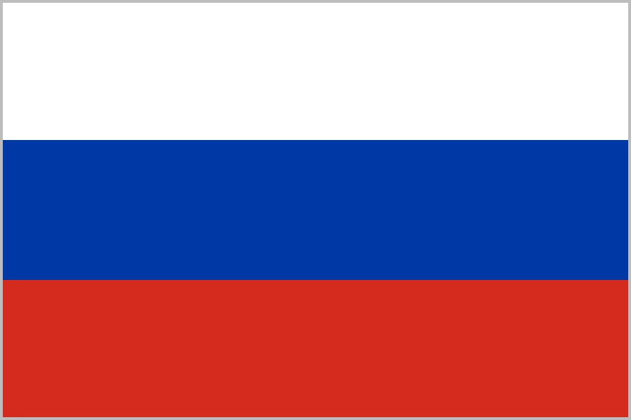
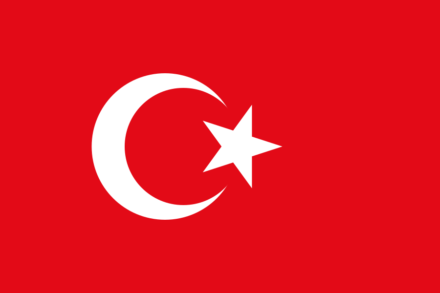
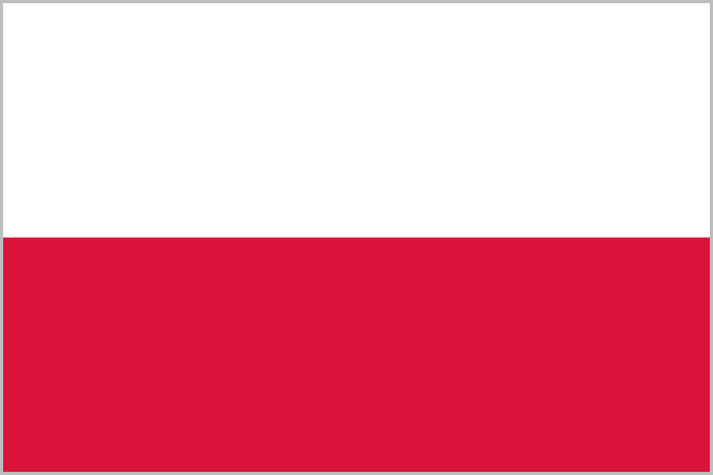

# KAAN KROSS
### 4R022 — ОФИЦИАЛЬНОЕ ЗАЯВЛЕНИЕ ОСНОВАТЕЛЯ

**Системы · Анализ данных · Программная инженерия · Стратегическое развитие**

*Независимое видение. Контролируемый доступ. Бескомпромиссные принципы.*

🏷️ `4R022` · `Kaan Kross` · `Founder Statement` · `Русский`

🌐 <a href="../T%C3%BCrk%C3%A7e/Kaan%20Kross%20TR.md"> Türkçe</a> · <a href="../English/Kaan%20Kross%20ENG.md"> English</a> ·  **Русский** · <a href="../French/Kaan%20Kross%20FR.md"> Français</a> · <a href="../German/Kaan%20Kross%20DE.md"> Deutsch</a> · <a href="../Spanish/Kaan%20Kross%20ES.md"> Español</a> · <a href="../Chinese/Kaan%20Kross%20ZH.md"> 中文</a> · <a href="../Japanese/Kaan%20Kross%20JA.md"> 日本語</a> · <a href="../Portuguese/Kaan%20Kross%20PT.md"> Português</a> · <a href="../Polish/Kaan%20Kross%20PL.md"> Polski</a> · <a href="../Ukrainian/Kaan%20Kross%20UA.md"> Українська</a>

<a href="../README.md">🏠 Index</a>

---

## 01 · ОБ ОСНОВАТЕЛЕ

Меня зовут **Kaan Kross**. Я наполовину турок, наполовину русский по происхождению и являюсь основателем бренда **4R022**.

Я предпочитаю не раскрывать публично свою личность, возраст, местонахождение и отдельные сведения о частной жизни. Этот выбор отражает **важность, которую я придаю личной конфиденциальности**, и границы, которые я поддерживаю между профессиональной деятельностью и частной жизнью.

Я предпочитаю, чтобы меня знали по моей публичной личности, моим работам и той информации, которую я сам решаю опубликовать. Отсутствие сведений о моей частной жизни не мешает оценке моих работ. Точно так же публикация проектов разработчиком не требует полного раскрытия его личной жизни.

Я не определяю себя лишь как человека, создающего приложения. Мои интересы сосредоточены на **программной инженерии, проектировании систем, анализе данных, оптимизации производительности, цифровой безопасности** и технических структурах, способных взаимодействовать друг с другом.

Для меня недостаточно просто заставить систему работать. Не менее важно, как она спроектирована, как взаимодействуют её компоненты, в каких границах она функционирует и как её можно развивать с течением времени.

Мой подход к работе основан на **аналитическом мышлении, технической дисциплине, последовательности и долгосрочном планировании**.

---

## 02 · ЧТО ТАКОЕ 4R022?

**4R022** — независимый технологический бренд, основателем которого я являюсь.

В рамках бренда я разрабатываю программные проекты, системные инструменты и технические решения для различных целей. Эти проекты не ограничиваются удовлетворением одной конкретной потребности; они также отражают мой подход к архитектуре программного обеспечения, производительности, удобству использования и устойчивой разработке.

Публичные проекты 4R022 — это та часть бренда, которая встречается с пользователями и сообществом разработчиков. Значительная часть этих проектов предоставляется **бесплатно** и призвана предлагать практические решения проблем, возникающих в повседневном использовании.

Однако определять 4R022 только через опубликованные приложения было бы неверно.

Помимо существующих проектов, бренд представляет собой **рабочую платформу**, охватывающую также процессы разработки, личные рабочие инструменты, внутренние технические компоненты и цели будущих проектов.

Решения о том, какие части этой структуры будут опубликованы, а какие останутся закрытыми, принимаются **осознанно**.

> **Публичные проекты — это видимая часть 4R022; они не обязаны представлять бренд целиком.**

---

## 03 · ПОДХОД К РАЗРАБОТКЕ ПО И ИНЖЕНЕРИИ

Я рассматриваю разработку программного обеспечения не просто как добавление функций или создание новых приложений.

Истинную ценность проекта следует оценивать по его **функциональности, стабильности, производительности, удобству сопровождения** и по тому, насколько он пригоден для дальнейшего развития.

Поэтому в процессе разработки я уделяю внимание технической документации, истории версий, оценке ошибок, процессам тестирования и улучшению производительности.

Я понимаю, что по мере роста программного обеспечения растёт и число деталей, которыми необходимо управлять. Новые функции могут усложнять существующую структуру; поэтому упорядочивание, оптимизация и пересмотр принятых решений так же необходимы, как и сама разработка.

Моя цель — не только создавать проекты, которые работают сегодня, но и строить **системы, которые можно развивать завтра**.

**Модульность и гибкость** также являются важной частью этого подхода. Я не считаю, что каждая функция должна быть обязательной для каждого пользователя. При необходимости дополнительные компоненты могут удовлетворять разные потребности и помогать управлять потреблением ресурсов системы.

Я измеряю технический успех не только масштабом системы, но и **тем, насколько эффективно она использует свои ресурсы**.

---

## 04 · АНАЛИЗ ДАННЫХ И СИСТЕМНОЕ МЫШЛЕНИЕ

Анализ данных — важная область для оценки систем и понимания событий.

Сами по себе данные не дают полной картины. Для корректной оценки необходимо понимать **источник, контекст, достоверность** данных и их связь с другой информацией.

Поэтому в аналитическом подходе важно различать **наблюдение и вывод, проверенную информацию и предположение**.

При изучении поведения системы более надёжные результаты может дать не фокусировка на одном симптоме, а анализ взаимосвязей между компонентами и возможных причин.

Тот же подход применим в таких разных областях, как разработка программного обеспечения, выявление проблем производительности, системное администрирование и цифровая безопасность.

Для меня аналитическое мышление — это не просто обладание большим объёмом информации. Главное — **правильно интерпретировать имеющиеся сведения, знать их пределы** и **ответственно использовать полученные результаты**.

---

## 05 · ЦИФРОВАЯ БЕЗОПАСНОСТЬ И ПРИНЦИПЫ ЗАЩИТЫ

В цифровом мире недостаточно просто скрываться.

Безопасность требует понимания систем, оценки рисков, контроля доступа, защиты данных и готовности к возможным проблемам.

То, что система снаружи выглядит простой, не означает, что она технически проста или лишена механизмов защиты. В то же время сложная архитектура сама по себе не гарантирует безопасность.

Надёжность достигается **продуманным проектированием, правильной конфигурацией, контролируемым доступом, регулярной оценкой** и применением необходимых мер.

В моих закрытых работах в рамках 4R022 я также считаю важным **сохранение конфиденциальности и границ доступа**.

Я считаю, что не обязан открывать публично все свои личные рабочие пространства. Вместе с тем для меня важно предоставлять как можно более ясную и точную информацию о проектах, которые я делаю публичными.

**Конфиденциальность и прозрачность могут применяться в разных сферах.** Объяснение назначения проекта и условий его использования не требует публикации всех его внутренних подробностей.

---

## 06 · АНОНИМНОСТЬ И ЛИЧНАЯ КОНФИДЕНЦИАЛЬНОСТЬ

Личная конфиденциальность для меня — не временный выбор и не рекламная стратегия.

Моя настоящая личность, возраст, местонахождение и сведения о частной жизни, которыми я не делюсь, являются частью моего личного пространства. Раскрывать ли эту информацию — **моё решение**.

Моя позиция в этом вопросе ясна: я открыт к изучению моих публичных работ; **неправомерное вмешательство в мою частную жизнь я не принимаю**.

Изучение моих проектов, высказывание технического мнения или критика опубликованных работ — это совсем иное поведение, чем попытки получить доступ к моим личным данным.

Первое — естественная часть публичного творческого процесса. Второе может нарушать границы личной конфиденциальности.

Тот факт, что мои личные данные не являются публичными, не означает, что разрешено их разыскивать или публиковать.

Я не обязан давать объяснения о границах своей анонимности по каждому запросу. Информация, которой я решил поделиться, является публичной; **информация, которой я не делюсь, сама по себе публичной не становится**.

---

## 07 · ЗАКРЫТАЯ СТРУКТУРА 4R022 И ПОЛИТИКА АВТОРИЗАЦИИ

Основателем и уполномоченным администратором закрытых систем 4R022 является **Kaan Kross**.

Между публичными проектами бренда и его внутренними системами, закрытыми рабочими инструментами и неопубликованными проектами существует **чёткое разграничение**.

Публичность приложения не даёт права доступа к не связанным с ним закрытым ресурсам или компонентам с ограниченным доступом. Разрешение на изучение репозитория не может толковаться как полномочие в отношении других учётных записей, серверов, файлов или систем.

**Несанкционированный доступ недопустим.**

Попытки получить доступ к закрытым ресурсам без разрешения, обойти защиту, получить данные или нарушить целостность систем могут, в зависимости от обстоятельств, быть технически изучены и переданы соответствующим платформам или уполномоченным органам.

Я оставляю за собой право определять объём информации, которая может быть раскрыта о внутренней архитектуре 4R022, закрытых проектах и моих личных методах работы.

Чтобы знать бренд в целом, не требуется раскрывать каждую внутреннюю деталь. Точно так же предположения о нераскрытом компоненте не создают никаких полномочий в отношении этого компонента.

> **Любопытство — не разрешение на доступ. Публичная открытость — не неограниченный доступ. Полномочия не возникают из предположений.**

Эти принципы выражают подход 4R022 к защите своих закрытых рабочих пространств.

---

## 08 · СОБСТВЕННЫЕ ПРИНЦИПЫ 4R022

4R022 — это структура, развивающаяся в соответствии с правилами и границами, которые я принял при ведении своей работы.

В основе этих принципов лежат **взаимное уважение, ответственность, защита конфиденциальности** и принятие необходимых мер против несанкционированного вмешательства.

К людям, которые общаются с нами уважительно, честно и конструктивно, мы относимся с такой же серьёзностью. Техническая критика и различные мнения естественны и ценны, пока соблюдаются границы.

В то же время **преследование, угрозы, умышленное причинение вреда, несанкционированный доступ или нарушение личной конфиденциальности** — это поведение, которое не станет нормой.

В таких случаях наш подход — не отвечать произвольно и не вступать в личные разбирательства, а оценить характер инцидента, сохранить необходимые доказательства, ограничить доступ и воспользоваться надлежащими путями.

У 4R022 есть собственные принципы. Эти принципы не дают никому неограниченной власти; они требуют, чтобы решения принимались в определённых границах и в рамках ответственности.

> **Уважение взаимно. Доступ основан на авторизации. Ответственность — принцип, который необходимо сохранять при любых обстоятельствах.**

---

## 09 · ДОЛГОСРОЧНОЕ ВИДЕНИЕ

Мои цели в сфере технологий не ограничиваются одним приложением или конкретным продуктом.

Я хочу разрабатывать программное обеспечение, отвечающее различным потребностям, развивать существующие проекты и, когда это уместно, обеспечивать их совместную работу с более масштабными системами.

Эти цели требуют со временем создавать новые проекты, совершенствовать существующие архитектуры и накапливать знания в разных технических областях.

Я не оцениваю долгосрочный успех только по заметности. Непреходящая ценность бренда также связана с **качеством его продуктов, последовательностью процессов разработки, техническим опытом** и реальной применимостью предлагаемых решений.

Поэтому мой приоритет — укреплять основы 4R022, развивать существующие работы и выстраивать структуру, способную в будущем создавать более масштабные проекты.

Масштаб и охват будущих проектов определятся выполненной работой и достигнутыми результатами.

---

## 10 · ИТОГОВОЕ ПУБЛИЧНОЕ ЗАЯВЛЕНИЕ

Я — **Kaan Kross**.

Как основатель 4R022, я продолжаю работу в области разработки программного обеспечения, проектирования систем, анализа данных и цифровой безопасности.

Мои публичные проекты составляют ту часть моего подхода к творчеству и технической работы, которая открыта для изучения. Мои закрытые рабочие пространства защищены в рамках личной конфиденциальности и границ авторизации.

О моей работе можно задавать вопросы, мои опубликованные проекты можно оценивать, а мои технические решения — критиковать. Однако это не означает, что моя личная информация или внутренние системы открыты для неограниченного доступа.

Будущее 4R022 и дальше будет определяться разрабатываемыми мной проектами и проделанной работой.

Мой фокус — **непрерывное развитие, техническая компетентность, системная работа и создание долгосрочной ценности**.

> **Личная конфиденциальность — это выбор. Безопасность системы — это ответственность. Техническая компетентность оценивается по результатам работы.**

<!-- signature -->

---

С уважением,

### **KAAN KROSS**
*Основатель и независимый разработчик — 4R022*

**Независимое видение. Контролируемый доступ. Бескомпромиссные принципы.**

`4R022` · `Kaan Kross`

